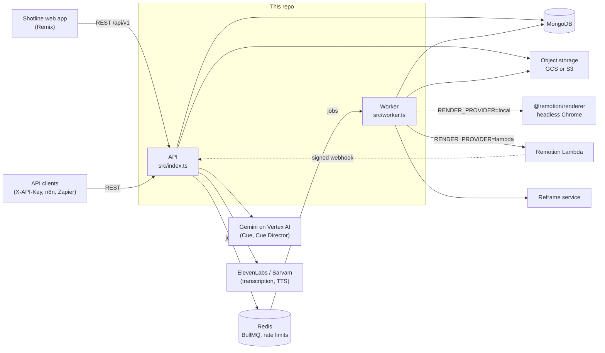

# Shotline — backend

The API and job workers behind **[Shotline](https://shotline.in)**, a video editor that runs in the browser. You upload footage, edit it on a timeline with captions, titles, transitions, voice-over and stock media, then export the video. **Cue**, the built-in editing assistant, can also make a whole first cut for you.

TypeScript on Node.js: Express, MongoDB (Mongoose), Redis and BullMQ, with Remotion for rendering. Storage and rendering can each run on **Google Cloud** or **AWS**, chosen by an environment variable.

---

## Architecture



The code is split into two apps that share it:

- **API** (`src/index.ts` → `src/app.ts`): Express with Helmet security headers, CORS, request IDs, Zod validation and rate limits stored in Redis. Routes are under `/api/v1` (auth, files, templates, projects, render, caption, transcriptions, reframe, voice, ai, stock, webhooks, admin). OpenAPI docs are served at `/api/v1/docs`, and `/health/live` and `/health/ready` report status.
- **Worker** (`src/worker.ts`): a separate process that runs the BullMQ workers: render, transcription, caption, file import, reframe, webhook delivery, account cleanup and maintenance. It waits for in-flight jobs to finish before it shuts down. Because API and worker are separate, a long render never slows down API requests.
- **MongoDB** holds users, sessions, projects, templates and their version history, render jobs, files, plans and the usage ledger. **Redis** holds the queues and the rate-limit counters.

---

## Cloud providers: GCP or AWS

Storage and rendering are configured independently. The defaults are what production runs today: **GCS** and **local** rendering on a GCP VM.

| Setting | Options | What it does |
|---|---|---|
| `STORAGE_PROVIDER` | `gcs` (default), `s3` | Where uploads, generated media and render outputs live |
| `RENDER_PROVIDER` | `local` (default), `lambda` | Where videos are rendered |

**Rendering: which to pick**

- **`lambda` (Remotion Lambda)** splits a render into 60-frame chunks and renders them on many Lambdas in parallel, so long or high-resolution exports finish much faster, and you pay per render rather than for an always-on machine. You need an AWS account with a Remotion function and site deployed. Renders finish through Remotion's signed webhook (`POST /api/v1/webhooks/remotion`). Without a webhook, the worker polls Lambda instead.
- **`local` (`@remotion/renderer` on the worker)** needs nothing from AWS. Renders run in a shared headless Chrome on the worker machine, and speed depends on its CPU. Each render reads the composition bundle that the frontend deploy builds. That bundle is pinned at the start of the render, so a deploy never changes a render that is already running.

**Storage: which to pick**

- **`gcs`** uses Application Default Credentials (on GCP, the VM's service account), so there are no key files. Signed URLs and POST policies are signed through IAM `signBlob`.
- **`s3`** uses the AWS SDK. Access keys are optional, and without them the SDK's default credential chain is used (for example an instance role).

All four combinations work, and the rest of the code doesn't know which one is active. `src/services/storage.service.ts` keeps one set of functions and hands each call to the GCS or S3 backend in `src/services/storage/`. Browser uploads have the same shape on both: a signed POST form, and a multipart upload whose parts go to signed PUT URLs (GCS's XML API speaks the S3 protocol). Every render output is signed and deleted wherever it is stored, so existing render links keep working after a provider switch.

Startup checks the chosen providers (`checkProviders` in `src/config/env.ts`). Choosing `s3` or `lambda` with settings missing stops the process with a list of what's missing. The defaults only print warnings, as they always have.

---

## Features

### Uploads and media
- **Direct-to-bucket uploads.** The API signs a POST policy that fixes the content type, the size range and the Content-Disposition. SVGs are stored as attachments so they can't run as pages on the media origin.
- **Resumable multipart uploads.** Large files go up in 8 MiB+ parts, each to its own signed URL. A dropped connection costs one part, and an upload can resume after a page reload. The server asks storage which parts actually arrived instead of trusting the browser's list.
- **Imports** from a URL, Google Drive, GIPHY, stock libraries (Pixabay) and Lottie. These stream through the worker with size limits and SSRF-safe requests (`src/utils/safeRequest.ts`).
- **File sniffing and probing.** Uploaded bytes are checked against the declared type, and ffprobe/ffmpeg only ever open URLs on our own storage.

### Rendering
- One lifecycle for every path (`src/services/renderLifecycle.service.ts`): the local worker, the Lambda poller, the Remotion webhook, the maintenance sweep and the status endpoint all complete or fail renders through the same conditional state transitions. A duplicate webhook, a late poll or a finish after a cancel can never apply twice.
- **Deadlines and recovery.** Renders past `RENDER_DEADLINE_MINUTES` are stopped and refunded. The maintenance sweep re-queues renders whose worker died, and in webhook mode it asks Lambda about renders that have gone quiet (a lost webhook).
- **Cancel** stops a local render within seconds. If a cancelled render finishes anyway, it isn't charged and its file is deleted.
- **Private outputs.** Renders are private objects. Users get a stable link, `/r/<id>?t=<token>`, that redirects to a short-lived signed URL. Deleting a render deletes its file, and the link stops working.
- **Template rendering API** with variables, for automation tools, plus outgoing webhooks signed with HMAC-SHA256 (`X-Webhook-Signature`).

### Usage ledger and plans
- Metered work (render, transcription and caption minutes, TTS characters, AI messages and images, Cue Director runs, …) goes through a **reserve → settle → release** ledger (`src/services/usage.service.ts`). Each step is idempotent per job, so retries and sweeps never double-charge, and failed work is refunded.
- Plans and their limits are stored in the database, with per-user overrides managed from the admin API.

### Auth
- Email and password, plus **Google, Apple and Facebook** OAuth with safe account linking.
- **Sessions** are stored in their own collection. Access tokens are short-lived, and **refresh tokens rotate** on every use: a token that's two rotations old means two holders, so the session is revoked. Revoking a session stops access within seconds.
- The Shotline web app keeps the tokens in **httpOnly cookies** on its own server, so browser JavaScript never sees them. Uploads that go straight from the browser use short-lived **upload tickets** instead.
- **API keys** (`X-API-Key`) are stored hashed and carry per-key permissions, which are checked per request type.

### Transcription and captions
- Transcription with ElevenLabs Scribe, giving word-level timings, cached per file.
- Caption generation and export, with caption styles and presets, plus captions that follow reframed (cropped) video.

### Voice
- Text to speech from **ElevenLabs or Sarvam** (`TTS_PROVIDER`), voice search, and users' own cloned voices.
- Audio clean-up, AI sound effects and dubbing into other languages. Dubs keep going even if the editor is closed, because the maintenance sweep moves them on.

### Reframe
- AI reframe turns horizontal footage into 9:16, 1:1 or 4:5 while keeping people in frame. With `REFRAME_SERVICE_URL` set, it uses the separate reframe engine service, which analyses a video once in the background and then plans each shape from that analysis, so a new shape or zoom level doesn't re-analyse the video. Otherwise it uses the bundled YOLO pose service (`yolo-service/`, Python).

### Cue: the editing assistant
- A chat assistant inside the editor, on **Gemini via Vertex AI**. It edits the timeline through tools, finds stock media and GIFs, generates images, and remembers each user's preferences.

### Cue Director: multi-agent first cuts
`src/services/director/` turns raw footage and a one-line request into a complete edit:

1. **Watching.** Gemini watches each clip (cached per file), and transcripts give exact word timings.
2. **Briefing.** The director (the strongest model) writes a creative brief.
3. **Cutting.** A story editor picks and orders the pieces, and cuts are snapped to speech. Problems found in the cut (pieces too short, pieces outside their clip) go back to it.
4. **Crafting.** A typographer, a motion designer, a sound designer and an asset scout work on the cut in parallel. Each answers in a fixed JSON vocabulary, which `compile.ts` turns into valid timeline elements, so the models make the creative choices and code keeps the project valid.
5. **Reviewing.** A storyboard of real frames is rendered with the same Remotion composition the export uses. The director scores it against the brief and sends notes back to the specialists for revisions, and the best-judged draft wins.
6. **Learning.** At most once a day, the director turns its own reviews and what users did with each draft into short craft rules per crew member. New rules only go live after an eval gate shows they don't make edits worse.

---

## Getting started

Requirements: Node.js 22, pnpm 11, MongoDB and Redis (`docker-compose.yml` starts both), and ffmpeg (bundled through `@ffmpeg-installer`).

```bash
pnpm install
cp .env.example .env          # then fill it in (see below)
docker compose up -d mongo redis
pnpm dev                      # API with reload
pnpm dev:worker               # worker with reload, in another terminal
```

Build and run for production with `pnpm build`, then `pnpm start` (API) and `pnpm start:worker` (worker).

### Environment

`.env.example` documents every variable. The main groups:

- **Core:** `MONGODB_URI`, `REDIS_URL`, `JWT_SECRET`, `JWT_REFRESH_SECRET`, `PUBLIC_API_URL`, `FRONTEND_URL`, `CORS_ORIGIN`. Production refuses to start without the secrets or with the development defaults.
- **Providers:** `STORAGE_PROVIDER`, `RENDER_PROVIDER`, plus the block for each choice:
  - GCS: `GCS_MEDIA_BUCKET`, `GCS_RENDERS_BUCKET`, `GCP_PROJECT_ID`
  - S3: `AWS_REGION`, `S3_BUCKET`, `S3_RENDERS_BUCKET`, optional `AWS_ACCESS_KEY_ID` / `AWS_SECRET_ACCESS_KEY`
  - Local renders: `REMOTION_SERVE_URL` (a bundle directory or URL), `RENDER_CONCURRENCY`, `REMOTION_CONCURRENCY`, `RENDER_DEADLINE_MINUTES`
  - Lambda renders: `AWS_REGION`, `REMOTION_FUNCTION_NAME`, `REMOTION_BUCKET`, `REMOTION_SERVE_URL` (the site's https URL), Remotion credentials, optional `REMOTION_WEBHOOK_URL` / `REMOTION_WEBHOOK_SECRET`
- **Integrations** (each feature is off until configured): OAuth clients, ElevenLabs / Sarvam, Vertex AI (`VERTEX_PROJECT`, model overrides), Pixabay, the reframe service, SMTP.

For local rendering, build the composition bundle from the frontend repo (`pnpm exec remotion bundle app/remotion/index.tsx --out-dir ../remotion-bundle`) and point `REMOTION_SERVE_URL` at that directory.

---

## Testing

```bash
pnpm test        # Vitest: ~480 tests
pnpm typecheck
pnpm lint
```

The integration tests run the real Express app against an in-memory MongoDB (`mongodb-memory-server`) with the queues faked. External services are faked at their SDK boundary: GCS and S3 clients, Remotion Lambda, Gemini, ElevenLabs and outgoing HTTP. The provider tests cover the startup checks, the S3 backend (presigned POST and part URLs, multipart, ranged reads, prefix deletes, render outputs) and the Lambda paths (polling, webhook signatures, deadlines, cancel, refunds, the maintenance sweep and account deletion). CI (`.github/workflows/ci.yml`) runs typecheck, lint and tests on every push to `main` and on every pull request.

---

## Deploy

- **Infrastructure as code:** `infra/terraform/` describes the GCP side: the app VM, networking and firewall rules, both storage buckets, and the service accounts and IAM, including the GitHub deployer identity. Terraform delivers the VM's setup files from `deploy/gcp/` (Caddy config, pm2 ecosystem, bootstrap and deploy scripts) through instance metadata.
- **On the VM**, pm2 runs the frontend, the API and the worker side by side, with Redis and Caddy for TLS. `shotline-deploy <backend|frontend> <sha>` deploys one commit of `main`: it builds it, and for the backend downloads Chrome for renders; frontend deploys also build the Remotion bundle that renders use.
- **GitHub Actions:** CI gates every change. `.github/workflows/deploy.yml` deploys after CI passes on `main` when the repository variable `AUTO_DEPLOY` is `true`, or by hand for a chosen commit. It authenticates with OIDC, so there are no long-lived keys in GitHub. On `main` it still targets the earlier AWS host; the GCP version, which uses Workload Identity Federation and IAP SSH, is waiting to be merged.
- `Dockerfile` and `docker-compose.yml` build the same app as containers for local stacks.

With `RENDER_PROVIDER=lambda`, deploy a Remotion Lambda function and site (`npx remotion lambda functions deploy`, `npx remotion lambda sites create`) with the same `remotion` version as the frontend's composition (4.0.400).

---

## Project layout

```
src/
  app.ts, index.ts      API app and entry point
  worker.ts             worker entry point
  config/               env (with provider checks), GCS and S3 clients, Redis, plans
  routes/, controllers/ HTTP layer (Zod validators in validators/)
  services/             domain logic: storage/, render*, usage, sessions, director/, ai/, tts/, audio/
  workers/              BullMQ processors
  models/               Mongoose models
test/                   Vitest integration tests; test/unit for unit tests
infra/terraform/        GCP infrastructure
deploy/gcp/             files installed on the VM
yolo-service/           Python YOLO pose service (fallback reframe engine)
```
